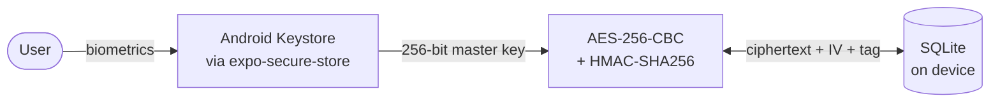

<div align="center">


# QubyLocker

**A 100% offline Android password manager — your passwords never leave the device.**


</div>

---

## 📖 About

QubyLocker is a personal password manager built around one rule: **no data ever leaves the phone**.
The production app doesn't even request internet permission — all passwords are encrypted and stored locally,
and the only way to read them is through the device's native biometric authentication.

It's a personal (non-commercial) project, built as hands-on practice in applied mobile security:
encryption, secure key storage, biometrics and the real-world quirks of shipping it all in a signed Android build.

## ✨ Features

- 🔐 **Biometric unlock** — no custom PIN; authentication is always handled by the operating system
- 🗄️ **Encrypted local vault** — entries stored in SQLite, passwords encrypted with AES-256
- 📵 **Zero network access** — internet permissions are stripped from the final Android manifest
- 🔒 **Auto-lock** — the vault locks itself as soon as the app goes to the background
- 🚫 **Screenshot blocking** — screen capture is disabled on sensitive screens
- 🗑️ **Biometric-confirmed deletion** — deleting an entry requires biometrics only (no PIN fallback)
- 🛡️ **2FA badge** — mark which accounts have multi-factor authentication enabled
- 🌗 **Dark mode** — with persisted preference

## 🛡️ Security Design



| Layer | How it works |
|---|---|
| **Master key** | 256-bit random key generated on first launch with a native secure RNG, stored in the Android Keystore with `requireAuthentication` — it can only be read after biometric authentication. |
| **Encryption** | AES-256-CBC for confidentiality + HMAC-SHA256 over `IV + ciphertext` (Encrypt-then-MAC) for integrity, with a separate derived MAC key. A fresh random IV is used for every entry. |
| **Storage** | Only ciphertext, IV and authentication tag are stored in SQLite — never plain-text passwords. |
| **Network** | `INTERNET`, `ACCESS_NETWORK_STATE` and `ACCESS_WIFI_STATE` are listed in `blockedPermissions`, so they are removed from the manifest even if a dependency declares them. |
| **Key safety** | If reading the master key fails, the app **never** generates a new one — that would make every saved password unrecoverable. |

## 🧠 Challenges Solved

- **CryptoJS mutating the IV** — `WordArray.concat()` mutates the original array, corrupting the IV on every entry so passwords never decrypted. Found by testing the full encrypt → store → decrypt cycle on a real device.
- **No secure randomness in React Native** — CryptoJS relies on browser/Node RNG APIs that don't exist in RN; IVs and keys are generated with `expo-crypto`'s native RNG instead.
- **Dev client needs internet** — Expo's dev client requires network access to reach Metro. Solved with separate EAS build profiles: internet only in the disposable `development` build, while `production` stays 100% offline.
- **Silent master-key rotation** — a failed key read used to trigger a new key, locking users out of their data. Fixed with a setup marker that distinguishes "first launch" from "authentication failed".

## 🛠️ Tech Stack

| Purpose | Technology |
|---|---|
| Framework | Expo SDK 57 · React Native 0.86 · TypeScript |
| Navigation | Expo Router (typed routes) |
| Storage | `expo-sqlite` |
| Key storage | `expo-secure-store` (Android Keystore) |
| Biometrics | `expo-local-authentication` |
| Crypto | `crypto-js` (AES / HMAC) · `expo-crypto` (secure RNG) |
| Screen protection | `expo-screen-capture` |
| Build | EAS Build (signed APK, sideloaded) |

## 📁 Project Structure

```
app/
├── (auth)/unlock.tsx        # biometric unlock screen
└── (app)/
    ├── dashboard.tsx        # password list
    └── entry/               # create / view / edit entry
src/
├── auth/                    # auth context, biometrics, auto-lock
├── crypto/                  # cipher (AES + HMAC) and master key storage
├── db/                      # SQLite client, schema and repository
├── components/              # UI components
├── hooks/                   # data hooks
├── theme/                   # light/dark theme
└── types/                   # TypeScript types
```

## 🚀 Getting Started

This project uses native modules (`expo-secure-store` with authentication, `expo-local-authentication`, `expo-screen-capture`),
so it **does not run in Expo Go** — a development build is required.

```bash
npm install
npx expo prebuild
npx expo run:android
```

Or with EAS:

```bash
eas build --profile development --platform android
```

### Building the final APK

```bash
eas build --profile production --platform android
```

This generates a signed `.apk` to be installed via sideload (outside the Play Store), with no network permissions.

## 📄 Documentation

- [`documentacao_tecnica.md`](documentacao_tecnica.md) — full technical documentation (in Portuguese)
- [`roteiro_qubylocker.txt`](roteiro_qubylocker.txt) — original project plan (in Portuguese)

## 📜 License

[MIT](LICENSE) © Willian Thiago Junges

---

<div align="center">

Made by [Willian Thiago Junges](https://github.com/WillianJunges) 🟢

</div>
